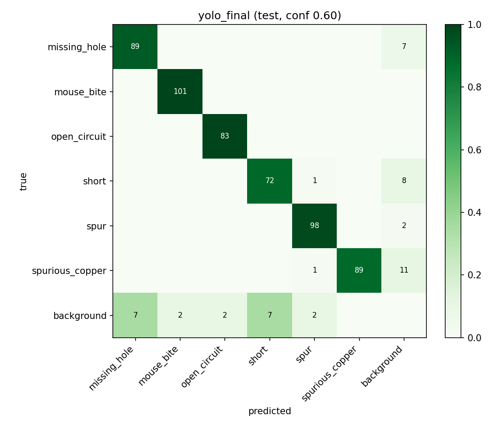

# PCB Defect Detection

AI Bootcamp final project — Computer Vision track. Author: Asad Hussain.

Detect six bare-PCB defect classes: `missing_hole`, `mouse_bite`, `open_circuit`, `short`, `spur`,
`spurious_copper`, using a trained YOLOv8n detector. Faster R-CNN remains an optional comparison baseline.

**Trained checkpoint and real test results are included.** The bundled `models/yolo_best.pt`
was evaluated on 120 held-out board images from two filename-prefix groups. mAP@0.5 is **94.74%**
and mAP@0.5:0.95 is **46.15%**. These are detection metrics for this partition, not accuracy or
production-line guarantees. The root `yolov8n.pt` is a COCO starting checkpoint; the app uses
`models/yolo_best.pt`. Full evidence is in [results/yolo_final](results/yolo_final).

## Start here

- [Windows / VS Code setup](LOCAL_SETUP.md) — Python 3.12, quoted paths, fail-fast setup.
- [Colab notebook](notebooks/colab_run.ipynb) — run the same pipeline on a free GPU.
- [Experiment plan and honest interpretation](EXPERIMENTS.md).
- [Seven-page report skeleton](REPORT_SKELETON.md) and [10-slide outline](PRESENTATION_OUTLINE.md).
- [File-by-file changes](CHANGES.md) and [complete replacement file contents](FULL_FILE_CONTENTS.md).
- [Streamlit deployment](DEPLOY.md).

Windows first setup:

```powershell
powershell -NoProfile -ExecutionPolicy Bypass -File .\setup.ps1
& ".\.venv\Scripts\python.exe" -m streamlit run streamlit_app/app.py
```

The bundled checkpoint runs on a CPU; no dataset download or retraining is required for the demo.
Use a GPU for optional retraining. See LOCAL_SETUP.md before choosing a CUDA PyTorch installation.
Running the training pipeline exports a new demo model, so back up `models/` first if you retrain.

## Dataset and split protocols

PKU-Market-PCB official resource: https://robotics.pkusz.edu.cn/resources/datasetENG
The project expects `Annotations/` and `images/`. It uses annotated source images with recognized
classes; inspect the actual run's counts instead of assuming an exact dataset size. Dataset variants
and directory structures differ; `--ann_dir` and `--img_dir` override discovery in the preparation script.

- **Image split:** deterministic, stratified by first annotated class, before tiling. Layouts may overlap.
- **Board split:** deterministic assignment of complete filename-prefix groups before tiling.
  `01_missing_hole_01` maps to group `01`. Verify that convention against actual template boards.
- Pipeline default: `--split-mode board`. Standalone preparation retains `--split-mode image` by default.
- `splits.csv`, `stats.json` and content-hashed `manifest.json` document actual membership and class support.
  Group counts approximate requested ratios; image counts and class balance are not guaranteed.

Report both protocols separately: held-out images of potentially familiar layouts versus held-out
board-prefix groups. They have different test images; their score difference does not isolate leakage.

## Methods and experiments

Native-resolution 640-pixel tiles, stride 480, retain small defects. Far-edge alignment covers borders;
small inputs are black-padded consistently in preparation and inference. Partially visible boxes
retaining at least 50% area and two pixels per side are kept. Tiles with an unlabelled partial defect
of at least 5% visibility are discarded, even beside a kept box. Train retains a seeded 10% of clean
tiles; validation/test retain all eligible clean tiles. These exclusions affect the tile evaluation domain.

`--representation full` retains original whole-board images for normal detector resizing/letterboxing.
`--augmentation off` disables the YOLO training augmentation pipeline, including optional Albumentations.
Model size, epochs, batch and seed are selectable. Use EXPERIMENTS.md's three-run core plan.

The one-command pipeline evaluates both representations on **original full boards**, using original
boxes once per board. The tiled model merges overlapping predictions with class-aware NMS; the full
variant predicts directly. A separate `--unit tile` evaluation remains available for context diagnostics.
The baseline uses 16-pixel smallest anchors and its own 800-pixel internal resize.

The shared numpy scorer implements COCO-style 101-point AP across IoU 0.50:0.95, not the complete official
COCO evaluator. It caps predictions at 100 per evaluation image. Operating confidence maximizes macro-F1
on validation only and is then fixed for test. Missing-class AP is undefined (JSON null / table N/A).

## Run commands (activated environment / Linux / Colab)

```bash
python -m pytest -q tests
python run_pipeline.py --profile quick --run-name smoke --skip-frcnn
python run_pipeline.py --profile gpu --run-name grouped_tiles --model yolov8n.pt --epochs 20 --batch 8 --skip-frcnn
python run_pipeline.py --profile cpu --run-name cpu_run
python -m streamlit run streamlit_app/app.py
```

Use `--raw "YOUR DATASET PATH"` for manual data. `--dry-run` prints safely quoted command arguments
without modifying outputs. Unique run names isolate experiments. The pipeline stops on failed steps
or missing outputs; completion records are invalidated after source/config/raw metadata changes.
`--force` rebuilds. An interrupted training step restarts; this is step-level resume, not epoch resume.

Individual scripts remain available:

```bash
python -m src.prepare_data --raw "YOUR DATASET PATH" --out data/pcb_yolo --split-mode board --clean
python -m src.train_yolo --data data/pcb_yolo/pcb.yaml --model yolov8n.pt --epochs 20
python -m src.train_frcnn --data data/pcb_yolo --epochs 20
python -m src.evaluate --model yolo --weights weights/yolo_best.pt --data data/pcb_yolo --unit board --name yolo
python -m src.evaluate --model frcnn --weights weights/frcnn_best.pt --data data/pcb_yolo --unit board --name frcnn
python -m src.compare --names yolo frcnn
python -m src.export_for_app --model yolo --weights weights/yolo_best.pt --results results/yolo
```

## Results and error evidence

### Recorded test run: YOLOv8n, tiled input, board-grouped split

| Metric | Result |
|---|---:|
| Test images / ground-truth defects | 120 / 562 |
| mAP@0.5 | 94.74% |
| mAP@0.5:0.95 | 46.15% |
| Precision / recall | 96.03% / 94.66% |
| Macro-F1 | 95.21% |
| Validation-selected confidence | 0.60 |
| True positives / false positives / false negatives | 532 / 22 / 30 |
| Mean inference time per board on recorded Tesla T4 | 219.74 ms |

Sources: [metrics.json](results/yolo_final/metrics.json), [per_class.csv](results/yolo_final/per_class.csv),
[provenance.json](results/yolo_final/provenance.json). Timing includes sequential tiled inference and
merging on already decoded images; it excludes image file reads and is not laptop CPU timing.

Train prefixes: `01, 04, 07, 08, 09, 12`; validation: `06, 10`; test: `05, 11`.
The saved source-image counts are 480 / 93 / 120 (693 total). Prefixes are disjoint; mapping them to
physical template identities remains an assumption to verify. The training history records 60 epochs.
An image-split comparison and controlled ablations have **not** been submitted; their table remains a plan.
The one-epoch Faster R-CNN validation log is not a completed matched test comparison and is omitted here.

| Class | AP50 | AP50:95 | Precision | Recall |
|---|---:|---:|---:|---:|
| missing_hole | 85.98% | 31.47% | 92.71% | 92.71% |
| mouse_bite | 98.41% | 53.78% | 98.06% | 100.00% |
| open_circuit | 99.34% | 54.88% | 97.65% | 100.00% |
| short | 90.22% | 35.55% | 91.14% | 88.89% |
| spur | 95.54% | 43.22% | 96.08% | 98.00% |
| spurious_copper | 98.92% | 57.98% | 100.00% | 88.12% |

The stricter-overlap AP is substantially lower; inspect localization errors rather than interpreting
mAP50 as box precision. This test set has no annotated boxes below 32 pixels in sqrt(area), so it
provides no measured recall for those size buckets. All test images contain annotated defects;
clean-board specificity is not established. See the [recorded analysis](results/yolo_final/README.md).



The saved run contains these evidence files (manual training used `training_args.yaml`, not the
pipeline's `training_config.json`):

| Artifact | Purpose |
|---|---|
| metrics.json / per_class.csv | Aggregate and class metrics, threshold, protocol and unit |
| confidence_sweep.json / conf_sweep.png | Validation-only operating-point evidence |
| size_by_class.csv | Recovered/total and recall by class and size |
| confusion_matrix.png | Class confusion and unmatched detections |
| errors.csv / errors.json | FP/FN observations, sizes, edge distances and source context |
| error_context.json | FP counts and rates with clean/defect-containing input denominators |
| error_examples/ | Real error illustrations with unique filenames |
| predictions.json / ground_truth.json | Inputs to reproduce reported scorer results |
| stats.json / splits.csv / manifest.json | Dataset statistics, membership and source hashes |
| training_args.yaml / training_history.csv | Submitted run settings and completed epochs |
| provenance.json | Environment, hardware, source and checkpoint hashes |

Board-mode errors do not identify contributing tiles. Use the additional tile diagnostic command in
EXPERIMENTS.md. Proximity to an edge is an observation, not proof that tiling caused an error.

## Repository contents

`src/`: download, prepare, train, predict, infer, score, evaluate, compare and export modules.
`run_pipeline.py`: fail-fast orchestration and isolated run completion records.
`streamlit_app/`: fast upload demo with cached inference, class legend, zooms and PNG/CSV downloads.
`tests/`: original regression tests plus grouped splitting, representation, error export, NMS/border,
confidence and resume checks. `.github/workflows/tests.yml`: Python 3.12 checks on Linux and Windows.
`setup.ps1`: Windows dependency installation and tests without environment activation.

## Limitations and verification

Only a small number of layout groups; verify actual group counts and prefix mapping. Dataset-domain
performance does not establish production-line performance. Confirm synthetic-defect provenance and
licensing from the source used. Tiny fragments below the exclusion threshold may remain in tiles;
overlap duplicates some tile ground truth. Border rejection assumes overlap and sufficiently small
objects. NMS merges same-class duplicates only; different-class duplicates can survive. One partition
is not statistical validation. Free GPU availability/runtime varies.

Ultralytics is pinned to the version exercised during this review; capture the actual full dependency
environment for your real run. Setup was exercised on Linux Python 3.12; run the provided Windows CI
and local setup to verify PowerShell/driver behavior on your machine. The submitted result is backed by saved predictions, ground truth and provenance;
other experiments remain unrun until their own evidence is produced.
